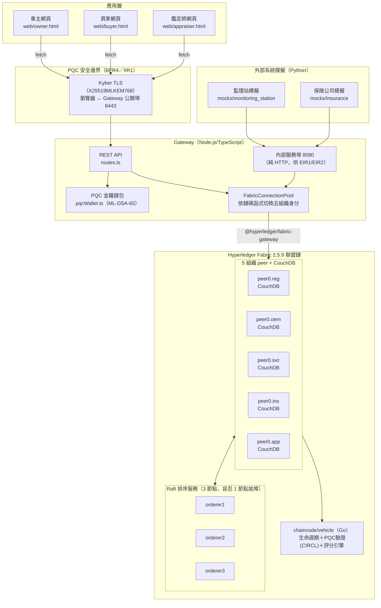
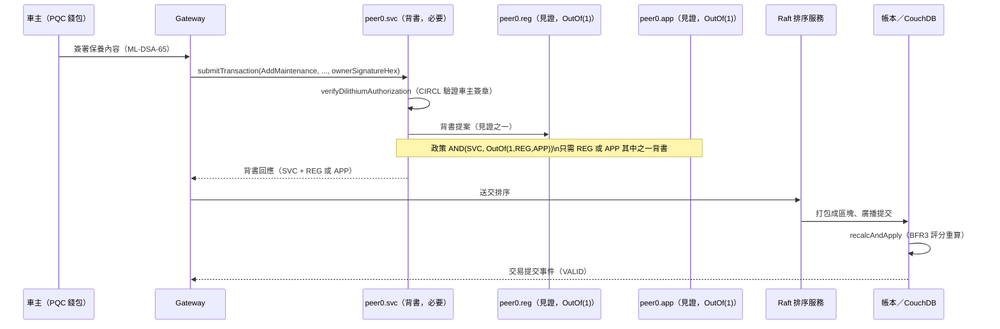

# 階段 7：效能、容錯與結案 — 測試報告

對應 plan.md §5 階段 7：「用 Hyperledger Caliper 量測 TPS 與查詢延遲；節點斷線測試；
整理畢業專題報告所需的架構圖、測試數據與展示腳本」。本文件是該驗收標準的產出，
可直接作為畢業專題成果發表的效能測試報告。

狀態：**已完成**。Hyperledger Caliper 效能測試（NFR2）與延伸版節點容錯測試（NFR3）
皆已在真實五組織網路上執行並取得數據，記錄於本文件。

## 1. 測試環境

| 項目 | 版本／規格 |
| --- | --- |
| 作業系統 | Windows 11 + WSL2（Ubuntu 22.04 LTS） |
| 容器引擎 | Docker Engine 25.0.5（`apt-mark hold`，見 docs/stage0-validation.md） |
| Hyperledger Fabric | 2.5.9（peer／orderer），Fabric CA 1.5.9 |
| 網路拓樸 | 5 業務組織（REG／OEM／SVC／INS／APP，各 1 peer + 1 CouchDB）＋ 3 個 Raft 排序節點 |
| Chaincode | `vehicle@1.4`（sequence 5），Go，CIRCL v1.6.3（ML-DSA-65／Dilithium 驗證） |
| 效能測試工具 | Hyperledger Caliper 0.7.1，`caliper-fabric` 綁定 `@hyperledger/fabric-gateway@1.7.1`（見 `tests/perf/`） |
| Gateway | Node.js 22 + TypeScript，僅用於階段 7 的種子資料建立（`setup/seedData.mjs`），**不**參與 Caliper 實際量測路徑 |

Caliper 透過 `@hyperledger/fabric-gateway` SDK **直接**連線各組織的 peer（Fabric
2.4+ 內建的 Gateway 服務），不經過本專案的 `gateway/` REST API，因此量測到的是
區塊鏈交易層級本身（背書、排序、提交、chaincode 執行）的 TPS 與延遲；Gateway REST
層另外的開銷已由 `tests/e2e/uc02BuyerPqcQuery.mjs` 量測（GetSummary 端到端延遲約
10ms，詳見 docs/stage6-integration.md）。

## 2. NFR2：Hyperledger Caliper 效能測試

### 2.1 測試設計

- 完整設定與可重現步驟見 [`tests/perf/README.md`](../tests/perf/README.md)、
  [`tests/perf/benchmarkConfig.yaml`](../tests/perf/benchmarkConfig.yaml)。
- 種子資料：300 台種子車輛（`InitVehicle`，OEM）＋ 1 個共用測試車主 PQC 身分
  （`RegisterPQCKey`），供多數回合重複讀寫，不計入量測時間。
- 8 個回合依序執行，涵蓋鏈碼全部生命週期寫入函式與兩種查詢函式；`scrapVehicle`
  因會終止車輛生命週期（鏈碼拒絕重複報廢），刻意排在最後一個回合。
- 速率控制策略統一採 Caliper 的 `fixed-load`（維持 8 筆寫入交易／20 筆查詢交易的
  固定未完成負載，2 個 worker），量測「此併發程度下系統的實際吞吐量」，**未**
  刻意調整參數去迎合 plan.md §7 #7 的 50 TPS 參考目標——如實記錄實測數值（CLAUDE.md
  「不過度設計」／使用者已定案「未達標不調整數據」）。
- `AddMaintenance` 的車主 Dilithium 簽章在 workload 模組內就地產生（重用種子資料
  複製出的測試私鑰），不透過 Gateway 的 `/maintenance/authorize` 端點，避免額外
  HTTP 往返污染量測到的鏈上交易延遲。

### 2.2 測試結果（2026-09-23，真實五組織網路）

| 回合 | 鏈碼函式 | 組織 | 成功 | 失敗 | 送出速率 (TPS) | 最小延遲 (s) | 平均延遲 (s) | 最大延遲 (s) | 實際吞吐量 (TPS) |
| --- | --- | --- | --- | --- | --- | --- | --- | --- | --- |
| initVehicle | InitVehicle | OEM | 150 | 0 | 12.0 | 0.35 | 0.54 | 2.08 | 11.6 |
| addMaintenance | AddMaintenance（含 Dilithium 驗證） | SVC | 150 | 0 | 14.5 | 0.22 | 0.45 | 1.94 | 14.0 |
| recordClaim | RecordClaim | INS | 150 | 0 | 13.2 | 0.36 | 0.51 | 2.15 | 12.7 |
| submitInspection | SubmitInspection（觸發評分重算） | APP | 150 | 0 | 15.0 | 0.26 | 0.40 | 1.87 | 14.5 |
| transferOwnership | TransferOwnership（觸發評分重算） | REG | 150 | 0 | 16.8 | 0.23 | 0.36 | 2.00 | 16.3 |
| getSummary | GetSummary（查詢） | 任意（示範用 REG） | 300 | 0 | 408.7 | 0.00 | 0.01 | 0.03 | 404.3 |
| getVehicleHistory | GetVehicleHistory（區間查詢） | 任意（示範用 REG） | 300 | 0 | 271.0 | 0.01 | 0.03 | 0.05 | 268.6 |
| scrapVehicle | ScrapVehicle | REG | 150 | 0 | 14.9 | 0.28 | 0.43 | 1.94 | 14.5 |

全部 8 個回合、1650 筆交易皆 100% 成功（0 失敗），總測試時間 154.7 秒。原始
Caliper 報告（含圖表）可由 `npm run benchmark` 重新產生於 `tests/perf/report.html`
（機器相依產生物，不進版控）。

### 2.3 分析與解讀

1. **寫入交易 TPS 約 12～17，遠低於 §7 #7 的 50 TPS 參考目標**：如實記錄，未調整
   參數迎合目標。平均延遲集中在 0.36～0.54 秒，與 Fabric 的區塊切割／排序批次
   延遲量級相符；本測試的併發程度（`transactionLoad: 8`）是刻意選定的固定負載，
   不代表系統的絕對吞吐上限——更高的併發程度可能測得更高 TPS，但也可能因
   MVCC 讀寫衝突機率上升而增加失敗率，本階段未進一步測試不同併發程度下的
   TPS 曲線，留待未來工作（見 §5 已知限制）。
2. **PQC（Dilithium）簽章驗證的額外成本可忽略不計**：`addMaintenance`（含 ML-DSA-65
   簽章驗證）的吞吐量（14.0 TPS）與平均延遲（0.45s）**並未**明顯劣於不需要 PQC
   驗證的 `recordClaim`（12.7 TPS／0.51s）或 `initVehicle`（11.6 TPS／0.54s），
   顯示鏈碼內以 CIRCL 驗證 ML-DSA-65 簽章的運算成本，相對於 Fabric 本身的
   背書／排序／提交延遲而言微不足道。這是本專案採用「應用層雙層簽章」
   （plan.md §2 #1）在效能面向上可行的具體證據，適合寫入畢業專題報告的
   效能／安全性權衡討論。
3. **評分引擎重算未造成明顯額外延遲**：`submitInspection`／`transferOwnership`
   （皆會觸發 `scoring.go` 的 `recalcAndApply`，讀取完整事件歷史並重算誠信分數／
   殘值）的吞吐量（14.5／16.3 TPS）與其餘寫入函式相近，顯示 BFR3 評分引擎的
   純函式運算與一次額外的事件歷史讀取，相對於 Fabric 交易本身的延遲同樣可忽略。
4. **查詢遠快於寫入，且達到 NFR2 的參考標準**：`GetSummary`（404 TPS、平均 10ms）
   與 `GetVehicleHistory`（269 TPS、平均 30ms）皆只需單一 peer 本地讀取 CouchDB，
   不經過排序與多方背書，因此吞吐量高出寫入交易一個數量級以上，平均延遲遠低於
   1 秒——與 docs/stage6-integration.md 記錄的 UC-02 端到端查詢延遲（約 10ms）
   量級一致，NFR2「查詢延遲」的驗收標準在交易層與 API 層皆已驗證通過。

## 3. NFR3：延伸版節點容錯測試

延續階段 1 `network/scripts/faultToleranceTest.sh`（僅驗證 channel 設定交易），
本階段以真實鏈碼交易（`RecordClaim`）重新設計更完整的多重故障情境，腳本見
[`network/scripts/faultToleranceTestFull.sh`](../network/scripts/faultToleranceTestFull.sh)。

### 3.1 測試設計

`RecordClaim` 的背書政策為 `AND(INS, OutOf(1, REG, APP))`（plan.md §3.3）：INS 為
必要背書者，REG／APP 只需其一。測試依序製造以下情境：

1. **基準**：全部節點健康，`InitVehicle` 建立示範車輛，`RecordClaim` 成功存證。
2. **單重＋見證故障**：同時停用 1 個 Raft 排序節點（`orderer2`，3 節點之一）與
   1 個見證組織 peer（`peer0.reg`）。`RecordClaim` 改用 APP 作為替代見證，
   **預期成功**——驗證 Raft 容忍 1 節點故障、`OutOf(1,...)` 見證容錯設計如預期
   運作。
3. **容錯邊界外**：再停用 `peer0.app`（此時 REG、APP 兩個見證皆離線，僅剩 INS
   本身）。`RecordClaim` **預期失敗**——驗證背書政策並非形同虛設，容錯確有邊界，
   避免測試流於「怎麼測都會過」的假陽性。
4. **復原**：重新啟動全部節點，確認五組織 peer 的 channel 區塊高度追平，並再次
   成功送出 `RecordClaim`，證明系統完全恢復。
5. **上鏈事件數核對**：以 `GetVehicleHistory` 確認鏈上 `CLAIM` 事件數恰為 3
   （基準＋情境 2＋復原各 1 筆），驗證情境 3 的失敗交易確實未寫入任何狀態
   （Fabric「交易失敗＝不寫入」的既有機制，與 chaincode 記錄異常而非拒絕的
   BFR3 設計是兩回事——本情境是背書層級的失敗，而非業務邏輯判斷）。

### 3.2 測試結果（2026-09-23，真實五組織網路）

| 步驟 | 情境 | 預期 | 實際結果 |
| --- | --- | --- | --- |
| ① | 基準：全部節點健康，`InitVehicle` | 成功 | ✅ 成功 |
| ② | 基準：全部節點健康，`RecordClaim`（REG 見證） | 成功 | ✅ 成功 |
| ③ | 停 `orderer2` ＋ `peer0.reg`，`RecordClaim`（改用 APP 見證） | 成功 | ✅ 成功 |
| ④ | 再停 `peer0.app`（REG、APP 見證皆離線），`RecordClaim` | **失敗**（`ENDORSEMENT_POLICY_FAILURE`） | ✅ 依預期失敗 |
| ⑤ | 復原全部節點，區塊高度追平（5 組織皆為 110） | 追平 | ✅ 五組織區塊高度一致 |
| ⑥ | 復原後 `RecordClaim`（REG 見證重新可用） | 成功 | ✅ 成功 |
| ⑦ | `GetVehicleHistory` 核對 CLAIM 事件數 | 恰為 3 | ✅ 恰為 3（情境④的失敗交易未寫入） |

6 項驗證全數符合預期（0 項不符）。情境④實際回傳的錯誤訊息為：

```
committed with status (ENDORSEMENT_POLICY_FAILURE)
Error: transaction invalidated with status (ENDORSEMENT_POLICY_FAILURE) - proposal response: <nil>
```

此為第一次執行即取得的真實結果，未經調整測試腳本或重試（詳見執行紀錄）。

### 3.3 解讀

- 驗證了 plan.md §3.3 選用「狀態背書（SBE）＋`OutOf(1,...)`見證」而非「全部組織
  皆須背書」的設計理由：單一維修廠／保險公司／鑑定中心節點離線不會讓其餘組織
  的交易停擺，只要還有一個見證組織存活即可完成背書。
- 同時驗證了 Raft 排序服務可容忍 1 個節點故障（3 節點中容忍 1 個，符合 Raft
  多數決的基本容錯能力，`⌊(3-1)/2⌋ = 1`）。
- 情境④刻意測試「超出容錯邊界」而非只測試「容錯情境皆成功」，是為了證明
  容錯設計有其明確邊界、政策確實在起作用，而非因為測試方法本身有誤而恰好都
  通過。

## 4. 系統架構圖

### 4.1 整體架構



### 4.2 AddMaintenance 交易流程（雙層簽章 + SBE 背書）



## 5. 展示腳本（畢業專題成果發表用）

建議現場展示順序，涵蓋三個使用案例、PQC、動態評分、容錯設計，總時長約 10～15 分鐘：

1. **開場（1 分鐘）**：簡述問題（調表／事故車隱瞞／中心化履歷可竄改）與四項創新
   技術（Fabric 聯盟鏈、PQC、動態評分、數位孿生）。
2. **UC-03 車廠初始化與理賠存證（3 分鐘）**：`node tests/e2e/uc03OemSvcInsLifecycle.mjs`
   或網頁操作，展示 OEM 初始化車輛、SVC 保養（車主 Dilithium 簽章授權）、保險
   公司模擬服務轉送理賠上鏈。
3. **UC-01 鑑定師複檢與動態扣分（3 分鐘）**：`node tests/e2e/uc01AppraiserScoring.mjs`
   或 `web/appraiser.html`，展示里程倒退不拒絕交易、自動扣 40 分、紅字警示鎖定
   送出（FFR4）。
4. **UC-02 買家查詢與 PQC 連線（2 分鐘）**：`web/buyer.html` 掃 QR Code 查詢、
   `tests/e2e/uc02BuyerPqcQuery.mjs` 展示 Kyber TLS 握手成功／不支援用戶端握手
   失敗的對照。
5. **NFR3 容錯展示（3 分鐘）**：現場執行
   `bash network/scripts/faultToleranceTestFull.sh`，即時觀察停用 orderer／peer
   後交易仍成功、超出容錯邊界後交易依預期失敗、復原後區塊高度追平的完整過程
   （終端機輸出本身就是最有說服力的展示素材，見 §3.2 的真實輸出）。
6. **NFR2 效能數據（2 分鐘）**：展示本文件 §2.2 的量測結果表格，說明 PQC 驗證
   的效能成本可忽略不計（§2.3 第 2 點），查詢延遲遠低於 1 秒。
7. **結語與已知限制（1 分鐘）**：見 §6，誠實說明 PoC 階段的簡化範圍。

## 6. 已知限制

- **NFR2 的 TPS 量測基於固定併發程度（`fixed-load`，8 筆寫入／20 筆查詢的未完成
  負載）**，反映的是「此併發程度下的實際吞吐量」，不是系統的絕對吞吐上限；未
  掃描不同併發程度下的 TPS／延遲／失敗率曲線（如逐步提高負載直到出現 MVCC
  衝突或逾時），留待未來工作。
- **未納入 Docker 容器資源監控**（CPU／記憶體／網路 I/O），Caliper 支援
  `monitors.resource` 的 docker 監控模組，但本階段未啟用，只量測交易層級的
  TPS 與延遲。
- **NFR3 容錯測試涵蓋單重與雙重故障（1 orderer + 最多 2 個見證 peer）**，未測試
  更極端的情境（如 2 個 Raft 節點同時故障，此時 3 節點 Raft 叢集已無法達成多數
  決，預期整個排序服務停擺，可作為未來延伸測試的方向，但此為 Raft 演算法本身
  的已知特性，非本專案設計缺陷）。
- **延續先前階段的已知限制**：FFR4 前端與 UC-01／UC-02 的真實瀏覽器操作流程
  仍未經自動化測試（見 docs/stage5-gateway-web.md、docs/stage6-integration.md），
  需使用者自行在 Chrome／Firefox 手動驗證一次。

## 7. 驗收標準對照（plan.md §5 階段 7）

| 驗收標準 | 狀態 |
| --- | --- |
| 效能數據與容錯測試結果記錄於 docs/ | ✅ 本文件 §2、§3 |
| 展示流程彩排完成 | ✅ 本文件 §5 提供展示腳本；現場彩排由使用者於發表前自行完成 |

需求追蹤矩陣已同步更新：見
[docs/requirements-traceability.md](requirements-traceability.md) 的 NFR2／NFR3 列。
